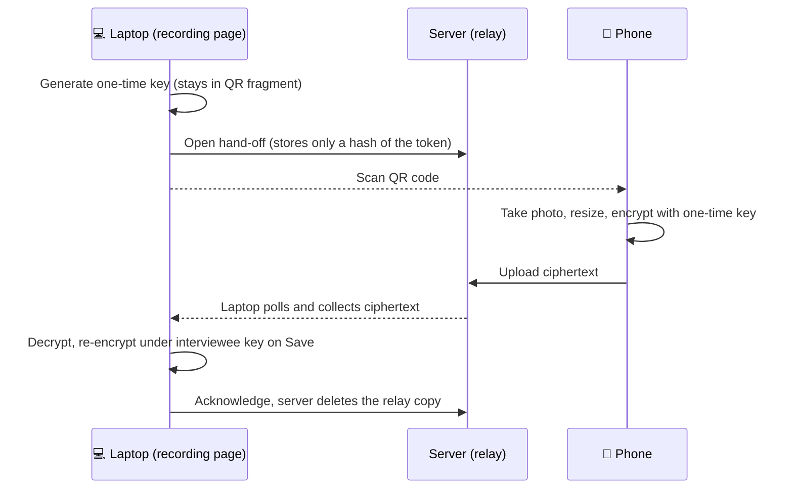
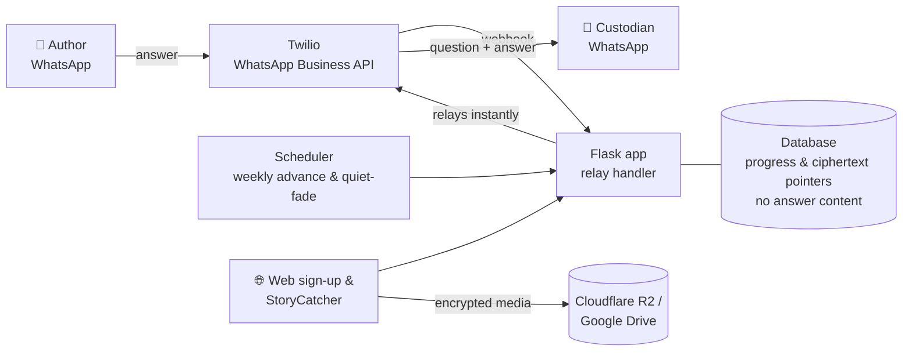

# 🌸 In My Time

**Web and mobile tools that give the elderly in our community a helping hand in using their voice to tell their life story, kept private, and kept by the family rather than a platform.**

🔗 **Live:** [www.inmytime.app](https://www.inmytime.app) · 🎬 **No-sign-up demo:** [inmytime.app/storycatcher/demo](https://www.inmytime.app/storycatcher/demo)

🔒 *Source code is private. I'm happy to walk through it in an interview.*

---

## The problem

Most families only realise how much of a parent's or grandparent's story they never heard once it is too late to ask. The tools that exist ask older people to learn an app, write long answers, or hand their memories to a company's servers.

In My Time meets people where they are, through **WhatsApp**, the one app most grandparents already use, and through a simple browser-based recorder for sitting down together. It is built so that **the story belongs to the family, not to the platform.**

## The In My Time suite

| Product | What it does | Privacy posture |
|---|---|---|
| **In My Time (WhatsApp)** | A weekly WhatsApp prompt walks a grandparent through the chapters of their life; every answer is relayed to a family member | **Shallow room:** relays and stores nothing |
| **StoryCatcher** | Record, keep and revisit interviews with a relative: audio/video, photographs and a LifeLine timeline | **Zero-knowledge:** encrypted in the browser; the server only holds ciphertext |
| **CircleofFriends** | Record a group conversation: friends or relatives together in one room | **Zero-knowledge**, same as StoryCatcher |
| **NationalTapestry** | A shared, moderated timeline of a country's memories across generations, written by certified contributors | Access-controlled rather than encrypted by design (everything in it is written to be shared) |

## How the WhatsApp journey works

1. **An adult child (the "custodian") signs up on the website** and chooses which chapters of a life to explore.
2. **The grandparent (the "author") receives a single WhatsApp consent message.** Nothing starts until *they* reply. Consent is in their hands, not a checkbox someone else ticked.
3. **Every Sunday the author gets one gentle question** from a 34-question journey across 8 chronological chapters: Childhood, People I loved, Working life, Places & journeys, and more.
4. **They answer however suits them:** text, a voice note or a photo. Each answer is **relayed instantly to the custodian**, with the question attached.
5. **Want to go deeper?** The author can reply *"more"* at any time for a tailored follow-up question.

## Privacy by design: the "shallow room"

The core architectural decision for the WhatsApp product:

> **The server relays each answer in the same request and stores nothing.** It keeps no message text and no transcriptions, and media is forwarded by reference and never downloaded.

- The database schema **has no column capable of holding an answer**. If an `answers` table ever appears in a migration, that is treated as an alarm bell.
- The only records kept are timestamps and the author's position in the question sequence.
- Even the admin view shows only progress (chapter, reply counts, days since last reply), **never story content**, including to me.
- Sign-up uses structured choices rather than free text, so no special-category personal data is collected.

### Designing for the end of life

The system **never assumes a death**. If an author goes quiet, it pauses patiently, then sends one gently worded check-in to the *custodian*, never to the author. Closing steps begin only after the family confirms. The worst case is always "it went quiet and waited", never a wrong assumption.

## StoryCatcher: recorded family interviews

A second module lets family members record interviews with relatives in the browser:

- 🎙️ **Guided interviews** using curated question packs, including packs derived from the **1937 Schools' Collection** (Irish Folklore Commission survey headings), plus **Capture a chat** for an unscripted recording
- 🧭 **Time Traveler:** a personalised, chronological set of questions built from a person's birth year, place and life events, with regional historical milestones placed on their timeline
- 🔐 **Client-side encryption:** recordings, photographs and names are encrypted in the browser, with per-interviewee keys. The server never holds a key and cannot read a word of it
- 👥 **Per-interviewee access control:** the account holder can invite reporters for specific people and revoke access individually, enforced server-side on every route
- 🗂️ **Bring-your-own storage:** recordings can go to Cloudflare R2 or the family's own Google Drive (OAuth with resumable uploads)
- 🕰️ **LifeLine:** a scrollable timeline from pre-1900 to today, where clips, photographs and notes are pinned to a decade and theme alongside world events for context, with photo thumbnails on the timeline and in playback
- 🎧 **Interviewee portal:** the storyteller can listen back from any browser with a PIN
- 📴 **Hands-free recording and an offline queue**, so a recording is never lost to a flaky connection
- 🎬 **Interactive demo** that runs entirely in the browser on sample data, with its own key store that can never touch a real account

### 📷 Start with a photograph

The best conversations often begin with a photo, so StoryCatcher has an explicit photograph-first route:

1. Gather the printed photographs and sit down together, then tap **Start with a photograph** and talk through each one.
2. Press Stop, then **snap or upload the photos you discussed**. They are attached to the recording before it is saved.
3. **Using a laptop? Scan the on-screen QR code with your phone**, take the picture, and it appears on the laptop within seconds. No app and no sign-in on the phone.
4. Photos show as thumbnails on the LifeLine and in playback, and can be **replaced later** with a better scan without breaking their place on the timeline.

**How the QR hand-off stays private:** the laptop generates a one-time encryption key that lives only in the QR code's URL fragment, which browsers never send to a server. The phone encrypts each photo before upload, and the server relays only ciphertext for at most 20 minutes, deleting it as soon as the laptop collects it. The laptop then re-encrypts the photo under the interviewee's own key when the recording is saved.

## Architecture

## Tech stack

| Area | Technologies |
|---|---|
| Backend | Python, Flask, scheduled jobs (weekly prompts, billing sweep, activity digests) |
| Messaging | Twilio, WhatsApp Business API, Meta-approved message templates, Web Push |
| Storage | PostgreSQL on Neon (SQLite in development; progress and metadata only), Cloudflare R2, Google Drive API |
| Security | WebCrypto client-side encryption (ECDH P-256, AES-GCM), per-interviewee keys, server-side access control, OAuth |
| Payments | Stripe, with deferred aggregated billing for question packs |
| Internationalisation | Flask-Babel, with a full German translation (~966 strings) and French and Spanish catalogs in place |
| Infrastructure | Render (moved from PythonAnywhere), Cloudflare DNS, Let's Encrypt, GitHub |
| Testing | Automated API test suites and end-to-end Playwright browser tests (real encryption, recording and playback) |

## Problems I solved along the way

**🔕 Alerts that failed silently.** Admin alerts weren't arriving, yet the messaging API reported every send as successful. The root cause was WhatsApp's 24-hour session rule: free-form messages are only delivered while a conversation is open. I added an automatic fallback to a pre-approved template message, with tests covering both paths.

**🧵 Lost context on follow-up answers.** When an author asked for a follow-up question, the custodian couldn't tell which question the reply answered. I added a short-lived pending-follow-up field (holding question text only, never answers) so the right question is attached to the next reply, and it clears automatically so stale context can't leak into later replies.

**🔐 HTTPS certificates that wouldn't issue.** Certificate validation kept failing because of how the registrar's DNS handled the record setup. Moving DNS to Cloudflare, with the records set to DNS-only, fixed it cleanly.

**🌍 Adding languages properly.** Rather than translating page by page, I built the internationalisation at the foundation, so adding a new language is now a documented, repeatable process.

**⏰ A scheduled job that failed with misleading errors.** A new 6-hourly digest job died first with a database error that turned out to be a silent fallback to an empty local database, because a blank setting on the service was overriding the shared configuration. Once fixed, the email step failed with "connection closed", which hid the mail server's real answer (bad credentials) behind a retry. I traced each layer from the logs, fixed the configuration, made the code fail loudly with a clear message and report which step broke, and removed a debugging aid that I realised could expose a credential. I recorded the lessons in the project's issue log.

**📷 Photos from a phone to a laptop without trusting the server.** Letting someone snap a printed photograph on their phone and have it appear in a laptop recording, while keeping the zero-knowledge promise, meant moving the encryption key through a QR code's URL fragment so it never reaches the server, relaying only short-lived ciphertext, and re-encrypting under the family's own key on save.

## What this project demonstrates

- Designing **privacy into the architecture**, not bolting it on afterwards
- Building on **real-world messaging platforms** and working within their rules (consent, templates, session windows)
- **Careful product thinking** for a sensitive, older audience
- **Testing at depth**, including browser tests that exercise real encryption and media playback
- **Operating a live system**: diagnosing production failures from logs, and writing down what was learned

---

*Built by [Barry Sisk](https://github.com/BBSISK) · Higher Diploma in Software Development, Maynooth University*
